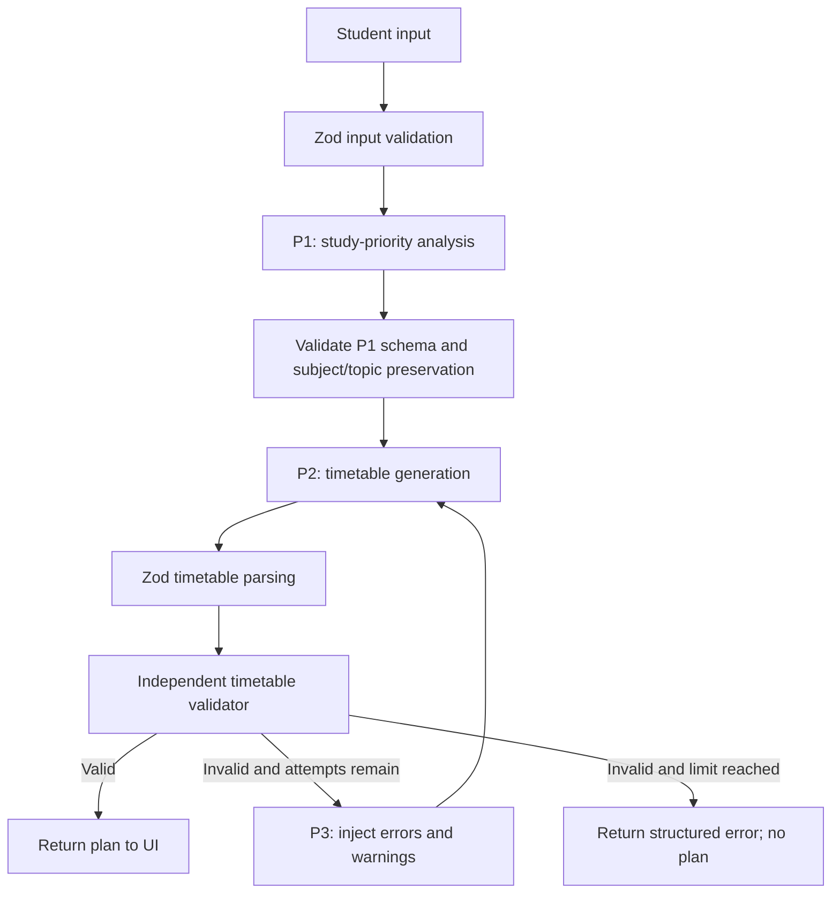
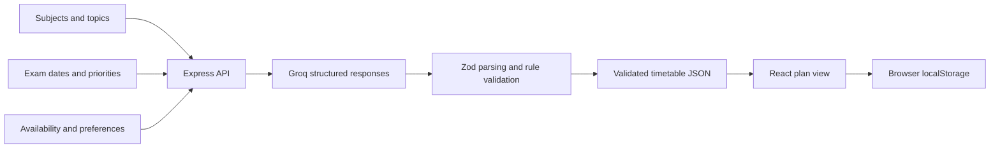
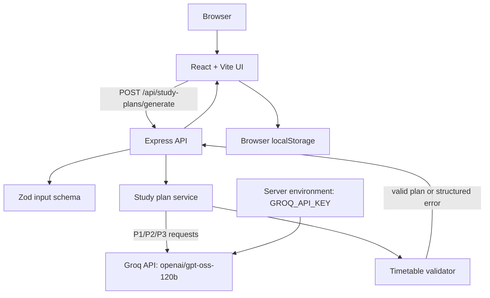

# PrepWise architecture diagrams

These Mermaid diagrams describe the implementation represented by the source tree.

## Prompt workflow and task decomposition

## Input–output flow

## System architecture

## Scope note

The product does not use a retrieval-augmented generation pipeline or a separate autonomous agent loop. The workflow is a chained prompt process with deterministic validation and bounded correction.